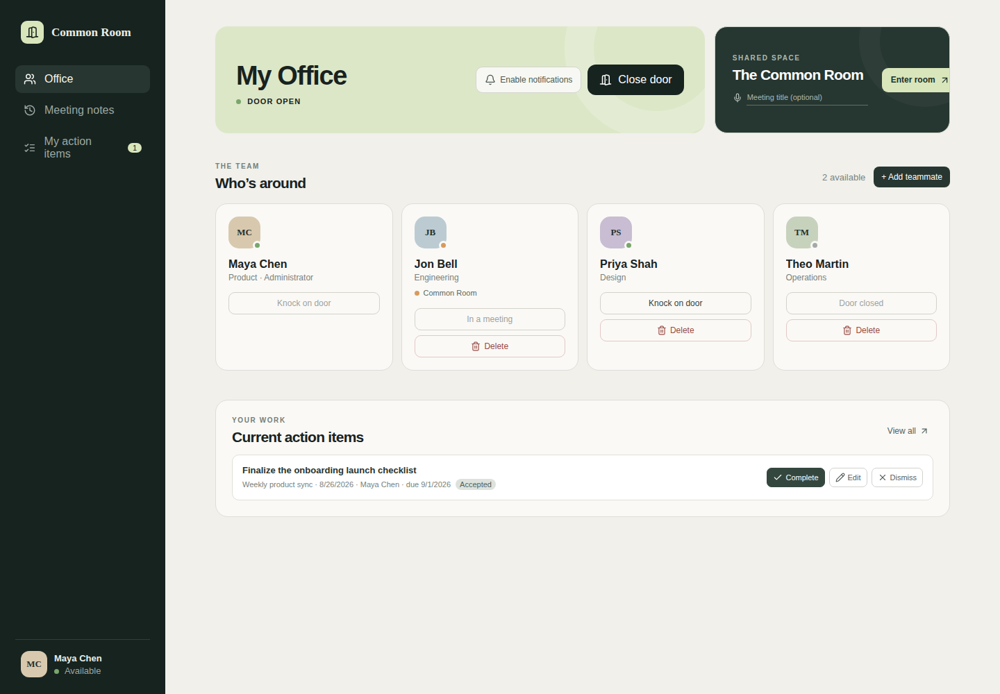

# Common Room

Common Room is a private virtual-office and conferencing application for teams. Each user has an office with an open or closed door, teammates can knock to request a private conversation, and everyone can join the shared Common Room. Calls are audio-first with optional camera and screen sharing.



Public Common Room sessions are recorded, transcribed, summarized, and made searchable across the company. Their action items are assigned to individual users. Private office meetings and their notes remain visible only to their participants.

## Features

- Invite-only accounts with administrator-managed users
- Office presence, door state, occupancy, and knock-to-enter requests
- Public Common Room and private two-person office meetings
- Audio-first calls with optional video and screen sharing
- Browser notifications for knocks and accepted invitations
- Self-hosted Agora audio recording in the background worker
- ElevenLabs transcription with admin-managed key terms
- OpenRouter summaries, decisions, and action-item extraction
- Searchable meeting notes and personal action-item workflow
- Automatic PostgreSQL migrations

## Architecture

This repository is an npm workspace containing:

- `apps/web` — React and Vite browser client
- `apps/api` — Fastify API, authentication, presence, and Agora token service
- `apps/worker` — Docker worker for recording, transcription, and analysis
- `apps/desktop` — Electron desktop client with a workspace-URL onboarding flow
- `packages/contracts` — shared client/server types
- `db` — PostgreSQL schema and migrations
- `deploy` — Docker Compose and Caddy configuration for a single-VM deployment

The web client calls the public API. The API and worker share PostgreSQL. The API mints short-lived Agora channel tokens, while the worker joins active channels as an audio-only recorder. Recordings exist only in the worker's ephemeral `/tmp` storage until successfully transcribed, then they are deleted.

## Provider accounts

A complete production deployment requires:

1. An Agora project with App Certificate authentication enabled. Copy its App ID and App Certificate.
2. An ElevenLabs API key with access to Speech to Text.
3. An OpenRouter API key with access to the model configured by `OPENROUTER_MODEL`.
4. A Linux VM with a public IP address and a DNS name pointing at it (see [VM requirements](#vm-requirements)).

The application does not require S3, Redis, or a separate object-storage service.

## Deploy to a VM

The whole stack runs on one Linux VM with Docker Compose. `deploy/compose.yaml` starts four containers:

- `web` — Caddy serving the built web app and proxying `/api` (websockets included) and `/health` to the API. It obtains and renews the HTTPS certificate automatically.
- `api` — the Fastify API
- `worker` — the recording, transcription, and analysis worker
- `db` — PostgreSQL 17, stored in the `pgdata` Docker volume

Only Caddy is published, on ports 80 and 443. The API, worker, and database are reachable only on the Compose network.

### VM requirements

- **x86_64 (amd64).** The Agora recorder only ships x86_64 native libraries, so ARM VMs such as AWS Graviton or Ampere won't run the worker.
- At least 2 vCPU, 4 GB RAM, and 20 GB of disk. The worker's first image build compiles the recorder with Maven and needs the memory.
- Any Linux that runs Docker Engine with the Compose plugin, such as Ubuntu 24.04 or Debian 12
- Inbound TCP 80 and 443, plus UDP 443 for HTTP/3. Port 80 has to stay open for certificate issuance and renewal.
- A DNS name whose A (and optionally AAAA) record points at the VM. Browsers only allow microphone and camera access over HTTPS, so calls won't work on a bare IP address. If you don't have a domain, use `<ip-with-dashes>.sslip.io` (for example `203-0-113-5.sslip.io`).

### Install

On a fresh Ubuntu or Debian VM:

```bash
curl -fsSL https://get.docker.com | sudo sh
sudo usermod -aG docker "$USER"   # then log out and back in

git clone <your repository URL> common-room
cd common-room/deploy
cp .env.example .env
```

Edit `deploy/.env`:

```text
DOMAIN=office.example.com
POSTGRES_PASSWORD=<openssl rand -hex 32>
SESSION_SECRET=<openssl rand -hex 32>
AGORA_APP_ID=<your Agora App ID>
AGORA_APP_CERTIFICATE=<your Agora App Certificate>
ELEVENLABS_API_KEY=<your ElevenLabs API key>
OPENROUTER_API_KEY=<your OpenRouter API key>
```

Use `openssl rand -hex 32` for the database password. It ends up inside a connection URL, and characters such as `@`, `/`, or `#` would break that URL. `WEB_ORIGIN` is derived from `DOMAIN` as `https://<DOMAIN>`, so it doesn't need setting.

Build and start:

```bash
docker compose up -d --build
docker compose logs -f
```

The first build takes several minutes while the worker image downloads and compiles the pinned Agora Linux Recording Java SDK using JDK 17.

### Create the first administrator

Once the stack is up, visit `https://<DOMAIN>`. If the database contains no users, the application displays **Create the first account**. That first account becomes an administrator and can invite or delete other users.

Alternatively, set `BOOTSTRAP_ADMIN_EMAIL`, `BOOTSTRAP_ADMIN_PASSWORD` (at least 10 characters), and `BOOTSTRAP_ADMIN_NAME` in `deploy/.env` before the first start. They're only used when the `users` table is empty. Remove the password afterward and run `docker compose up -d` again.

### Transcription key terms

Administrators get an **Admin** page in the sidebar for the key terms sent to ElevenLabs with every recording. Listing product names, internal jargon, and other words the model would otherwise mis-hear makes them come out spelled correctly, which also improves the summaries and action items generated from the transcript.

The display names of everyone in a meeting are added automatically, so the list only needs the words the model would not otherwise know. Each term must be 50 characters or fewer, at most 5 words, and cannot contain `< > { } [ ] \`; up to 1000 terms are accepted.

ElevenLabs charges 20% more for transcription on any request that carries key terms. While the list is empty no key terms are sent and nothing extra is billed.

### Migrations

No separate migration command is required. At API startup, Common Room creates the `schema_migrations` table and applies unapplied SQL migrations from `db` in a transaction.

### Verify the deployment

1. Open `https://<DOMAIN>/health`. It should report `ok: true` and `database: "connected"`.
2. Create the first administrator and sign in.
3. Invite a second test user and sign in from another browser profile.
4. Join the Common Room from both profiles and confirm two-way audio.
5. Leave the room and watch `docker compose logs -f worker` for recording finalization, transcription, and analysis.
6. Confirm that the completed session appears in meeting-note search with its summary and action items.

If the site doesn't load, check `docker compose logs web`. Caddy logs certificate errors there, which usually mean DNS doesn't point at the VM yet or port 80 is blocked. If calls report that calling is not configured, confirm the Agora values in `deploy/.env` and run `docker compose up -d` again. If calls work but notes never appear, inspect the worker logs and confirm the ElevenLabs and OpenRouter keys.

### Update

```bash
cd common-room
git pull
cd deploy
docker compose up -d --build
```

Restarting the worker during a live call loses that call's recording, so update between meetings.

### Back up and restore

All persistent state lives in PostgreSQL, including profile photos, so a database archive is a complete backup. From the `deploy` directory:

```bash
./db-export.sh > common-room-$(date +%F).dump
./db-import.sh common-room-YYYY-MM-DD.dump
```

`db-import.sh` replaces everything in the VM database and asks you to type `replace` first (`--yes` skips the prompt). It restores into a scratch database and swaps that in only after the restore succeeds, so a corrupt or incomplete archive leaves the current data untouched. The API and worker are stopped for the swap and restarted afterward. On restart the API applies any migrations the archive is missing, so archives from older versions import cleanly.

Copy archives off the VM. A snapshot of the VM disk also captures the `pgdata` volume.

### Move from Render

`db-export.sh` also accepts a connection URL, so the VM can pull the data straight from the Render database.

1. Deploy the VM as described above and confirm `https://<DOMAIN>/health` responds. Don't create any accounts, because the import replaces them.
2. In the Render dashboard, open the database's **Connect** menu and copy the **External Database URL**. If the database's access control restricts inbound IPs, add the VM's IP address.
3. Suspend the Render API and worker services so nothing changes during the copy. Users can't use the old instance from here on.
4. On the VM, from the `deploy` directory:

   ```bash
   ./db-export.sh 'postgresql://common_room:<password>@<host>.render.com/common_room' > render.dump
   ./db-import.sh render.dump
   ```

5. Sign in at `https://<DOMAIN>` with an existing account and check that users, meeting notes, and action items are present. Everyone must sign in again, because session cookies belong to the old hostname.
6. Copy `AGORA_APP_ID`, `AGORA_APP_CERTIFICATE`, `ELEVENLABS_API_KEY`, and `OPENROUTER_API_KEY` from the Render services into `deploy/.env` if you haven't yet, then run `docker compose up -d`.
7. Once you're satisfied, delete the Render services and database. Keep `render.dump` as a backup.

The export uses `pg_dump` from the `db` container (PostgreSQL 17) and refuses a newer source server. If the Render database is newer, raise the `postgres` image tag in `compose.yaml` before the first start. For PostgreSQL 18 and later images, also change the `pgdata` mount to `/var/lib/postgresql`.

### Using a managed database

To use a hosted PostgreSQL instead of the `db` container, remove the `db` service and its `depends_on` entries from `deploy/compose.yaml`. Then set `DATABASE_URL` on the `api` and `worker` services to the provider's connection string and set `DATABASE_SSL` to `"true"`.

## Local development

Requirements:

- Node.js 22 or newer
- PostgreSQL
- Agora credentials for real calls

Create the local environment file and install dependencies:

```bash
cp .env.example .env
npm install
npm run dev
```

Create the PostgreSQL database referenced by `DATABASE_URL` before starting. The API automatically runs migrations. The web app runs at `http://localhost:5173` and proxies `/api` and `/health` to `http://localhost:4000`.

Without `DATABASE_URL`, the API starts in an in-memory demonstration mode. Without Agora credentials, the dashboard works but joining a real call returns an integration-not-configured response.

The production recording worker depends on the Agora native SDK included by its Dockerfile. For an end-to-end local recording test, build and run that Docker image with access to the same PostgreSQL database and the worker environment variables. Running `npm run start:worker` directly does not install the native recorder.

## Desktop app

The Electron client is a desktop shell around a Common Room web deployment. On first launch it shows an onboarding screen so the user can select which workspace URL to connect to — a recent workspace, the local Vite app at `http://localhost:5173`, or a custom URL. The chosen address is saved and loaded on later launches. Use **Workspace → Change workspace…** to pick a different URL.

Enter the web URL you normally open in a browser, not the API hostname. The desktop app probes the URL before connecting; if the probe fails, you can still choose **Connect anyway**.

```bash
npm run dev:desktop    # compile the Electron main process and launch it
npm run dist:desktop   # package platform installers into apps/desktop/release
```

GitHub Actions workflow `.github/workflows/desktop.yml` type-checks and tests the desktop package, then builds unsigned Linux, macOS, and Windows installers and uploads them as artifacts. macOS and Windows will show an unsigned-app warning until signing certificates are configured.

## Environment reference

| Variable | Service | Required | Purpose |
| --- | --- | --- | --- |
| `DOMAIN` | Caddy | VM | Public hostname; Caddy issues its certificate and `WEB_ORIGIN` is derived from it |
| `POSTGRES_PASSWORD` | Database | VM | Password for the bundled PostgreSQL container |
| `VITE_API_URL` | Web | Optional | Absolute API URL; leave empty to call `/api` on the web origin. Embedded at build time |
| `WEB_ORIGIN` | API | Production | Exact allowed web origin and invitation-link origin |
| `CROSS_SITE_COOKIES` | API | Only without the proxy | `true` sends the session cookie as `SameSite=None; Secure; Partitioned` |
| `DATABASE_URL` | API, worker | Production | PostgreSQL connection string; set by `deploy/compose.yaml` |
| `DATABASE_SSL` | API, worker | No | `true` connects to PostgreSQL over TLS; defaults to `true` when `NODE_ENV=production`. Compose sets `false` for the bundled database |
| `SESSION_SECRET` | API | Production | Session signing secret; generate with `openssl rand -hex 32` |
| `AGORA_APP_ID` | API, worker | For calls | Agora project identifier |
| `AGORA_APP_CERTIFICATE` | API, worker | For calls | Agora token-signing secret |
| `ELEVENLABS_API_KEY` | Worker | For transcription | ElevenLabs Speech-to-Text credential; key terms are configured in the app, not here |
| `OPENROUTER_API_KEY` | Worker | For analysis | OpenRouter credential |
| `OPENROUTER_MODEL` | Worker | No | Analysis model; defaults to `openai/gpt-5.6-luna` |
| `EMPTY_ROOM_GRACE_MS` | Worker | No | Delay before an empty meeting recording is finalized |
| `WORKER_POLL_INTERVAL_MS` | Worker | No | Worker polling interval; defaults to 5000 ms |
| `RECORDING_TEMP_DIR` | Worker | No | Ephemeral recording directory |
| `AGORA_RECORDER_JAR` | Worker | No | Recorder JAR path inside a custom worker image |
| `BOOTSTRAP_ADMIN_EMAIL` | API | No | Creates the initial admin when paired with a password |
| `BOOTSTRAP_ADMIN_PASSWORD` | API | No | Initial admin password; remove after bootstrap |
| `BOOTSTRAP_ADMIN_NAME` | API | No | Initial administrator display name |
| `PORT` | API | No | HTTP port; defaults to 4000 |
| `NODE_ENV` | API, worker | No | Enables secure cookies and the default PostgreSQL TLS behavior |

Never expose `AGORA_APP_CERTIFICATE`, `ELEVENLABS_API_KEY`, `OPENROUTER_API_KEY`, `SESSION_SECRET`, or `DATABASE_URL` to the browser or commit them to Git.

## Development commands

```bash
npm run dev          # web and API in watch mode
npm run dev:desktop  # launch the Electron desktop client
npm run build        # build all workspaces
npm run typecheck    # type-check all workspaces
npm test             # run tests
npm run dist:desktop # package desktop installers for the current OS
```

### Refresh the README screenshot

The screenshot uses the API's built-in demo data and isolated local ports, so it does not read or modify your development database.

```bash
npx playwright install chromium # first run only
npm run screenshot:readme
```

The command starts temporary API and web processes, captures a 1440 × 1000 browser view, and replaces `docs/common-room.png`.

## Operational notes

- Worker recordings are ephemeral. A worker restart during a live recording can lose that recording.
- A recording is deleted immediately after a valid transcript is saved. Failed transcription attempts retain it temporarily for retry and eventually remove it after the retry limit.
- Public Common Room notes are company-wide. Private office notes are restricted to meeting participants.
- Browser notifications require each user to grant notification permission.
